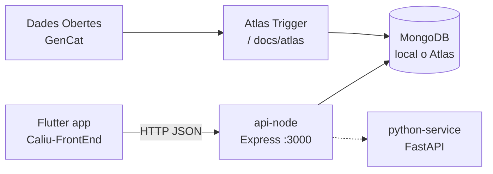

# Arquitectura — Caliu

## Components

| Peça | Repo / path | Rol |
|------|-------------|-----|
| App mòbil | Caliu-FrontEnd | Mapa, cerca, fitxa; consumeix només l’API |
| api-node | `apps/api-node` | REST: `/health`, `/events`, `/events/:id`, `/events/categories` |
| python-service | `apps/python-service` | Servei auxiliar (intern a Docker) |
| MongoDB | Compose o Atlas | Col·lecció `esdeveniments` |
| Ingesta | Atlas Trigger + `docs/atlas/` | Omple la BD des de dades obertes |

## Contracte

- Fitxer font de veritat: [`openapi.yaml`](openapi.yaml)
- Coordenades GeoJSON: `[lng, lat]`
- Errors: `{ "error": "missatge" }`

## Entorns

| Entorn | API | Dades |
|--------|-----|--------|
| Dev local | `localhost:3000` + Compose | Seed o Atlas |
| Mòbil físic | `http://IP_PC:3000` | Mateixa API |
| Demo / profe | URL pública HTTPS | Atlas preferiblement |
